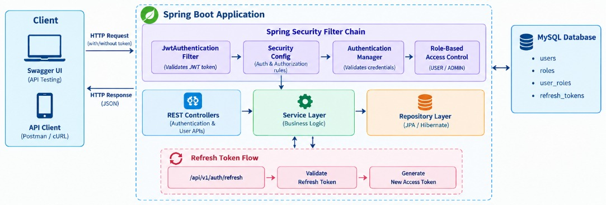

# Authentication System — Spring Boot, JWT & Spring Security

A backend authentication and authorization system built using **Java, Spring Boot, Spring Security, JWT, and MySQL**. The project demonstrates user registration, credential-based login, access and refresh token handling, protected REST APIs, role-based access control, and persistent user management.

**Repository:** [Authentication_System](https://github.com/RutujaKavilkar/Authentication_System)

## Architecture




## Project Overview

The application follows a layered backend structure that separates HTTP request handling, authentication and business logic, persistence, security configuration, and exception handling.

The authentication flow uses Spring Security to validate credentials, JWTs to authenticate protected requests, and MySQL to persist application data. Access tokens and refresh tokens have distinct purposes, and the refresh-token flow uses a database-backed token record.

The APIs can be explored through Swagger UI, with screenshots documenting registration, login, token refresh, protected-resource access, and administrative user operations.

## Key Features

- **User Registration:** Creates user accounts, encodes passwords using BCrypt, and persists user information.
- **Credential-Based Login:** Authenticates credentials through Spring Security's `AuthenticationManager` and authentication provider.
- **JWT Access Tokens:** Issues signed access tokens for authenticated API requests.
- **Refresh Token Handling:** Separates refresh tokens from access tokens and supports an API for refreshing access.
- **JWT Authentication Filter:** Validates incoming access tokens and establishes the authenticated security context.
- **Role-Based Access Control:** Supports configured guest and administrator roles, including `ROLE_GUEST` and `ROLE_ADMIN`.
- **MySQL Persistence:** Stores user, role, and refresh-token data using Spring Data JPA and Hibernate.
- **REST API Design:** Separates authentication and user-management endpoints into dedicated controllers.
- **API Documentation:** Uses Swagger UI / OpenAPI to explore and manually test API requests.
- **Centralized Error Handling:** Uses custom exception and API error-response classes.
- **Configuration by Environment:** Provides `.env.example` to document configuration variable names without publishing actual credentials.

## Technology Stack

| Area | Technologies |
|---|---|
| Language | Java |
| Framework | Spring Boot |
| Authentication & Authorization | Spring Security |
| Token Security | JWT, JJWT |
| Password Encoding | BCrypt |
| Database | MySQL |
| Persistence | Spring Data JPA, Hibernate |
| API Architecture | REST APIs |
| API Documentation | Swagger UI, OpenAPI |
| Build Tool | Maven |
| Development & API Tools | IntelliJ IDEA, Git, GitHub, Postman |

## How Authentication Works

### 1. User Registration

The registration request is handled by `AuthController` and delegated to the authentication service implementation.

The service encodes the password with BCrypt, checks for duplicate email addresses through the user service, assigns the configured guest role, and persists the user.

### 2. User Login

The login request is authenticated through Spring Security's `AuthenticationManager` and the configured authentication provider, which uses the custom user-details service.

After successful authentication, the application generates an access token and a refresh token. The refresh-token record is stored in the database.

### 3. Accessing Protected APIs

The `JwtAuthenticationFilter` intercepts incoming requests that require JWT authentication.

The filter uses `JwtService` to validate the token and check that it is an access token. It then loads the user details and establishes the authentication in Spring Security's `SecurityContextHolder`.

The security configuration determines which requests are public and which require authentication or authorization.

### 4. Refreshing Tokens

The refresh endpoint validates that the submitted token is a refresh token. The token's identifier (`jti`) is used to look up the corresponding refresh-token record in the database before issuing a new access token.

Keeping access-token and refresh-token validation distinct helps prevent a refresh token from being used as an access token.

## API Endpoints

The authentication endpoints implemented in the project include:

| Method | Endpoint | Purpose |
|---|---|---|
| `POST` | `/api/v1/auth/register` | Register a user |
| `POST` | `/api/v1/auth/login` | Authenticate credentials and obtain tokens |
| `POST` | `/api/v1/auth/refresh` | Refresh the access token |

### User Management

The project also includes user-management APIs for retrieving user information and administrative operations. The screenshots below demonstrate retrieval by email and ID, listing users, and administrator access scenarios.

For exact HTTP methods, paths, request bodies, and access rules, refer to the current controller mappings and Swagger UI. This avoids documenting routes that may differ from the actual implementation.

## API Testing Evidence

The following screenshots document the API scenarios tested through Swagger UI. **Click a link to open the corresponding image.** The images are stored in the repository's `images/` directory.

### 1. Registration and Login

- [User Registration — Request](images/User_Registration.png)
- [User Registration — Response](images/User_Registration_response.png)
- [User Login — Request](images/User_Login.png)
- [User Login — Response and Tokens](images/User_login_response.png)

### 2. Token Refresh and Security

- [Refresh Token API — Successful `200 OK` Response](images/Refresh_Token_API_Success_200_OK.png)
- [Attempt to Access a Protected Resource Without an Access Token](images/User_access_without_access_token.png)

### 3. User Information

- [Fetch User Details by Email](images/User_fetching_details_via_email.png)
- [Fetch User Details by Generated ID](images/User_fetching_details_via_generated_id.png)

### 4. Administrative Access

- [Administrator — Retrieve All Users](images/Admin_gets_all_user.png)
- [Administrator — Retrieve User by ID](images/Admin_fetching_details_via_Id.png)
- [Administrator — Retrieve User by Email](images/Admin_fetching_details_via_its_email.png)
- [Administrator — Access Another User's Details by ID](images/Admin_access_other_user_details_via_userId.png)

## Project Structure

The main application code is organized under `com.substring.auth.app`.

```text
src/
├── main/
│   ├── java/com/substring/auth/app/
│   │   ├── AuthBackend.java
│   │   ├── config/
│   │   │   ├── APIDocConfig.java
│   │   │   └── ProjectConfig.java
│   │   ├── dtos/
│   │   │   ├── ApiError.java
│   │   │   └── ErrorResponse.java
│   │   ├── exceptions/
│   │   │   ├── GlobalExceptionHandler.java
│   │   │   └── ResourceNotFoundException.java
│   │   └── auth/
│   │       ├── config/
│   │       │   ├── AppConstants.java
│   │       │   ├── JwtAuthenticationFilter.java
│   │       │   └── SecurityConfig.java
│   │       ├── controllers/
│   │       │   ├── AuthController.java
│   │       │   └── UserController.java
│   │       ├── entities/
│   │       │   ├── Provider.java
│   │       │   ├── RefreshToken.java
│   │       │   ├── Role.java
│   │       │   └── User.java
│   │       ├── helpers/
│   │       │   └── UserHelper.java
│   │       ├── payload/
│   │       │   ├── LoginRequest.java
│   │       │   ├── RefreshTokenRequest.java
│   │       │   ├── TokenResponse.java
│   │       │   └── UserDto.java
│   │       ├── repositories/
│   │       │   ├── RefreshTokenRepository.java
│   │       │   ├── RoleRepository.java
│   │       │   └── UserRepository.java
│   │       └── services/
│   │           ├── AuthService.java
│   │           ├── UserService.java
│   │           └── impl/
│   │               ├── AuthServiceImpl.java
│   │               ├── CustomUserDetailService.java
│   │               ├── JwtService.java
│   │               └── UserServiceImpl.java
│   └── resources/
│       ├── application.yaml
│       ├── application-dev.yml
│       ├── application-qa.yml
│       └── application-prod.yml
└── test/
    └── java/
```

*This is a representative structure of the core backend components; verify the current repository before treating the tree as an exhaustive file listing.*

### Responsibilities of the Main Components

| Component | Responsibility |
|---|---|
| `AuthController` | Handles registration, login, and token-refresh requests |
| `UserController` | Exposes user-management endpoints |
| `AuthServiceImpl` | Coordinates registration and authentication-related operations |
| `UserServiceImpl` | Handles user creation, retrieval, and persistence-related operations |
| `SecurityConfig` | Configures request security, authentication, and authorization |
| `JwtAuthenticationFilter` | Processes JWTs on protected requests |
| `JwtService` | Generates and validates JWTs and distinguishes token types |
| `CustomUserDetailService` | Loads user details for Spring Security |
| Repositories | Access persisted users, roles, and refresh-token records |
| `GlobalExceptionHandler` | Provides centralized exception handling |

## Run Locally

### Prerequisites

- JDK compatible with the project's configured Java version
- MySQL
- Git

### 1. Clone the repository

```bash
git clone https://github.com/RutujaKavilkar/Authentication_System.git
cd Authentication_System
```

### 2. Configure MySQL and application settings

Review `.env.example` for the configuration variable names used by the project.

Configure the database URL, username, password, and JWT secret using the configuration mechanism supported by the active Spring profile. Create the required MySQL database before launching the application.

The presence of an `.env.example` file does not mean Spring Boot automatically loads a `.env` file. Supply configuration through the mechanism your application actually uses.

**Never commit real database credentials, JWT secrets, or OAuth client secrets.**

### 3. Start the application on Windows

```powershell
.\mvnw.cmd spring-boot:run
```

If Maven is installed, you can alternatively run:

```bash
mvn spring-boot:run
```

### 4. Open Swagger UI

After the application starts, open:

[http://localhost:8080/swagger-ui/index.html](http://localhost:8080/swagger-ui/index.html)

Use the available API documentation to inspect request schemas and test the endpoints.

## Configuration Reference

The example configuration documents variables such as:

| Variable | Purpose |
|---|---|
| `DB_URL` | MySQL connection URL |
| `DB_USERNAME` | Database username |
| `DB_PASSWORD` | Database password |
| `JWT_SECRET` | JWT signing secret |

Other variables may be present in `.env.example` for optional integrations. Only configure integrations that are supported by the active application setup.

## Current Project Scope

The repository currently focuses on the **Spring Boot authentication backend**. Core registration, login, and refresh-token scenarios have been manually tested through Swagger UI, with evidence provided above.

Frontend integration is not yet complete, and the additional authentication flow is not being presented as a verified, working feature. The repository documents the backend implementation without claiming that these unfinished parts are production-ready.

## Developer

**Rutuja Kavilkar**

- [GitHub](https://github.com/RutujaKavilkar)
- [LinkedIn](https://linkedin.com/in/rutuja-kavilkar)

---

*Focused on backend engineering, API security, authentication flows, and maintainable Spring Boot application design.*
